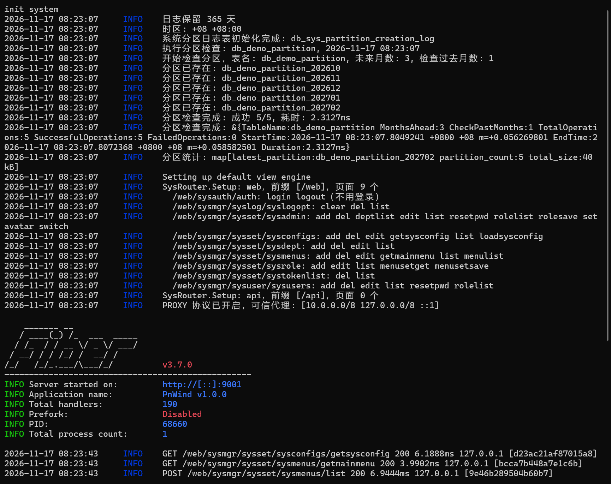

# PnWind

PnWind 是一个 Go 后端框架，用来快速搭建企业中后台的用户管理系统：内核轻量、上手快、性能好。后端基于 Fiber v3、sqlx 和 PostgreSQL（连接池也支持 ClickHouse），配套基于 vue-pure-admin 的管理前端。

> **状态：** 开发中，还没有发布正式版本，接口随时可能变化。

## 特性

- **轻量。** 内核只做基础设施：配置、数据库连接池、启动和优雅退出、基础中间件、日志、任务管理。代码平铺直叙，没有多余的抽象。
- **上手快。** 一个页面三个文件（控制器、服务、结构体），照着现成的页面写。接口地址、参数校验、权限、操作日志都按约定自动对上。
- **性能好。** HTTP 层是 Fiber v3（fasthttp），数据库用 sqlx 手写 SQL、参数化查询。
- **登录与鉴权。** JWT 登录，一个账号只能有一处登录，权限细到按钮，操作日志入库。
- **八个系统页面。** 基础设置、管理员、角色、菜单、部门、在线用户、操作日志、用户，带一套管理前端。
- **优雅退出。** 退出时等定时任务、后台协程和进行中的请求全部做完，不设超时。
- **任务管理。** 按 cron 表达式定时执行的任务，和常驻的后台协程，都由内核管着。
- **分区表管理。** 给按月分区的表提前建好后面几个月的分区，带一张演示表。
- **运维用得上的。** 健康检查（`/livez`、`/readyz`）、请求编号、访问日志、PROXY 协议、性能剖析（pprof）、按天分目录的日志。
- **三个系统。** Windows、Linux、macOS 都能编译，主要面向 Linux 部署。Windows 上整套实测过，Linux 上实测过内核部分（日志、信号、退出码），macOS 只验证过编译。
- **便于 AI agent 开发。** 开发约定写在 [AGENTS.md](AGENTS.md) 和 [project-memory/](project-memory/README.md) 里，人和 agent 共用。

## 技术栈

| 部分 | 用到的 |
|---|---|
| 后端 | Go 1.26、Fiber v3、sqlx、lib/pq、clickhouse-go、zap、viper、golang-jwt、go-playground/validator |
| 前端 | Vue 3、Vite、TypeScript、Element Plus、Pinia（vue-pure-admin 7.0.0） |
| 数据库 | PostgreSQL；ClickHouse 可选 |

## 目录

| 路径 | 内容 |
|---|---|
| `main.go` | 装配清单：读配置、连数据库、挂中间件和路由、登记定时任务、启动 |
| `core/` | 内核，只做基础设施，不知道业务的约定。说明见 [core/CORE.md](core/CORE.md) |
| `syscore/` | 业务层的公共部分：页面注册和分发（`routers`）、登录校验和权限（`middleware`）、操作日志（`logutils`）、响应码和助手函数（`utils`）、WebSocket（`PnWebSocket`） |
| `sysauth/` | 登录、退出 |
| `sysmgr/` | 八个系统页面；页面集中在 `sysmgr/00_registercontroller.go` 里注册 |
| `sql/` | 建表（`0001_create_tables.sql`）、初始数据（`0002_seed_data.sql`） |
| `conf/` | 配置文件 `dbconfig.json` |
| `views/` | 模板目录：服务启动时加载当前目录下 `views/` 里的 `.tpl` 模板（现在的页面都不渲染模板） |
| `web/` | 管理前端 |
| `docs/` | 文档里用的图片 |
| `build_win.cmd`、`build_linux.cmd` | 编译脚本，产物放进 `_bin/` |
| `project-memory/` | 开发规范和 agent 工作规范 |

## 快速开始

需要 Go 1.26.11 及以上、PostgreSQL（开发和测试用的是 17；建表脚本里分区表带主键，至少要 11）；构建前端另需 Node.js（`^20.19.0` 或 `>=22.13.0`）和 pnpm 9 及以上。

```sh
git clone https://github.com/pony5551/PnWind.git
cd PnWind
```

编译好的东西都放在仓库根目录的 `_bin/` 里，调试和发布都用它。这个目录整个不进仓库：

```
_bin/
├── PnWind.exe        后端的可执行文件（Linux、macOS 上是 PnWind）
├── conf/             它自己的一份配置文件 dbconfig.json
├── views/            模板目录
├── public/           前端的构建产物
├── logs/             运行时的日志（程序自己建）
└── uploads/          上传的文件（用到时才有）
```

1. **建库。** 建一个空的数据库，依次执行 `sql/0001_create_tables.sql`（建表）和 `sql/0002_seed_data.sql`（初始数据）。以后表结构或初始数据有变化时，`sql/` 里会多出 `upgrade_<日期>_<表名>.sql`：已经建过表的库，按脚本开头写的先后和注意事项执行。

2. **配置。** 新建 `_bin/conf/`，把 `conf/dbconfig.json` 复制进去，填上数据库的地址、账号、口令、库名，把 `JwtSecret` 换成自己随机生成的一串。常用的几项：

   | 配置项 | 说明 |
   |---|---|
   | `ServerAddr` | 监听地址，例如 `:9001`。一定要写 |
   | `dbs` | 数据库，一个标签一组：`DBDriver`（`postgres` 或 `clickhouse`）、`DBHost`、`DBPort`、`DBUser`、`DBPass`、`DBName`。主库的标签是 `db1`，必须有 |
   | `JwtSecret` | 登录令牌的签名密钥，至少 32 个字符，自己随机生成一串，不要外传。不够长服务不启动 |
   | `LoadRuters` | 装哪几组路由，每一项是组名和地址前缀，例如 `{"name": "web", "prefix": "/web"}` |
   | `DeviceId` | 节点号（0 到 1023），用来生成雪花 ID，几个实例不能相同 |
   | `OpenDataDelete` | 是否开放删除数据 |

   其余的（`ProxyProtocol`、`ProxyTrusted`、`PprofAddr`、`LogDir`、`LogFileOnly`、`LogKeepDays` 等）见 [core/CORE.md](core/CORE.md)。

3. **编译后端。** Windows 上在仓库根目录执行 `build_win.cmd`，产物是 `_bin\PnWind.exe`；`build_linux.cmd` 在 Windows 上交叉编译出 Linux 用的 `_bin\PnWind`。在 Linux、macOS 上直接执行 `go build -o _bin/PnWind .`。重新编译之前要先停掉正在跑的服务。第一次把仓库里的 `views/` 也复制成 `_bin/views/`（没有它服务照样启动，只是多一条加载模板失败的警告）。

4. **构建前端。** 产物在 `web/dist`，复制成 `_bin/public`：

   ```sh
   cd web
   pnpm install
   pnpm build
   ```

5. **启动。** 进到 `_bin/` 里启动，用浏览器打开 `http://127.0.0.1:9001`：

   ```sh
   cd _bin
   ./PnWind.exe
   ```

   一定要先进到 `_bin/` 里再启动：服务按当前目录找 `conf/`、`views/`、`public/` 和 `uploads/`。日志写在可执行文件旁边的 `logs/[日期]/` 里。

   启动之后，控制台里大致是这样：先是日志保留几天、时区、分区检查的结果，接着列出装了哪几组路由、每个页面有哪些操作，然后是 Fiber 的启动信息（监听地址、进程号）；之后每个请求一行访问日志：方法、地址、状态码、耗时、来源地址、请求编号。

   

6. **登录。** 默认管理员的登录名是 `admin`，密码是 `admin123`（写在 `sql/0002_seed_data.sql` 开头的说明里）。上线前必须改。

开发前端时不用每次构建：后端照上面启动，在 `web/` 里执行 `pnpm dev`，开发服务器监听 8848 端口，把 `/web` 开头的请求转给 `http://127.0.0.1:9001`。

## 接口

路由按组装，一组一个地址前缀，由配置项 `LoadRuters` 决定。现在的页面都注册在 `web` 这一组，前缀是 `/web`。

- **登录：** `POST /web/sysauth/auth/login`，请求体 `{"username": "...", "password": "..."}`。`password`（和下面的 `password2`）不是明文：是明文连做三次 MD5 之后的 32 位小写十六进制串，前端的登录页就是这样提交的，直接调接口时要自己先算（默认管理员的 `admin123` 算出来是 `105dad91250a07b716d6a714a3e676b8`）。响应的 `data.accessToken` 放进之后每个请求的 `Authorization: Bearer <令牌>` 头里。一个账号只能有一处登录：已经在别处登录着时回 `-10034`，带上二次密码 `password2` 再登录，会把那一处踢下线。退出是 `POST /web/sysauth/auth/logout`。
- **页面：** `/web/<页面地址>/<act>`，例如部门列表是 `POST /web/sysmgr/sysset/sysdept/list`。除了登录页，都要先登录，而且这个操作要在菜单表里配了权限（取主菜单 `getmainmenu`、取系统参数 `getsysconfig` 登录了就能调）。有哪些页面、每个页面有哪些 act，启动时会打印出来，`GET /web/` 也返回这一份。
- **响应：** 统一是 `{"code": 0, "message": "", "data": ...}`。`code` 为 0 表示成功，负数是错误码（定义在 `syscore/utils/mgr_define.go`）。业务上的错误 HTTP 状态码仍然是 200；令牌有问题（无效，或者已经退出、被顶替）是 401；地址不存在是 404。
- **健康检查：** `GET /livez`、`GET /readyz`，不用登录。
- **WebSocket：** `/ws`。

## 开发

- 怎么写一个页面、数据库的约定、日志和后台任务的用法、不能碰的红线：[AGENTS.md](AGENTS.md)。
- 内核的结构、启动和退出的流程、每个配置项：[core/CORE.md](core/CORE.md)。
- 开发规范和 agent 工作规范（每条规矩和它的理由）：[project-memory/README.md](project-memory/README.md)。

交出一处改动之前：Windows、Linux、macOS 三个系统的 `go build ./...` 都要通过（`GOOS` 分别设成 `windows`、`linux`、`darwin`，加 `CGO_ENABLED=0`），改过的文件 `gofmt` 干净。

## 测试

`core/` 下面有四个包带单元测试：

```sh
go test ./core/database ./core/pnlogrus ./core/pntask ./core/validation
```

其中连数据库的测试要设环境变量 `PNWIND_TEST_DSN`（形如 `postgres://账号:口令@地址:端口/库名`），没有设置时自动跳过。

不要写成 `go test ./core/...`：它会连第三方库的副本 `core/validation/govalidator` 一起跑，那个包自己的测试代码过不了 `go test` 自带的 `go vet` 检查，会显示失败，和本项目的代码无关。

## 参与

欢迎提 issue 和 pull request。动手之前先读 [AGENTS.md](AGENTS.md) 和 [project-memory/README.md](project-memory/README.md)：这个项目对"只改该改的地方""不加用不上的东西"要求比较严，改动越小、越直接越好。在自己的分支上改、提交，发 pull request 时写明改了什么、测了什么、没测什么。

## 致谢

- 后端：[Fiber](https://github.com/gofiber/fiber)、[sqlx](https://github.com/jmoiron/sqlx)、[lib/pq](https://github.com/lib/pq)、[zap](https://github.com/uber-go/zap)、[viper](https://github.com/spf13/viper) 等，完整的依赖见 `go.mod`。
- 前端：[vue-pure-admin](https://github.com/pure-admin/vue-pure-admin)（MIT），`web/` 是在它的 7.0.0 上改的，它的许可证在 `web/LICENSE`。

## 许可证

[MIT](LICENSE)
